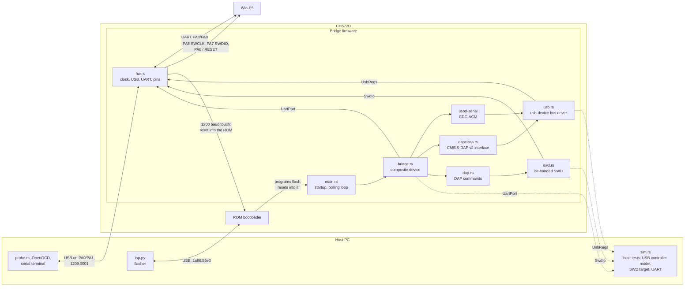
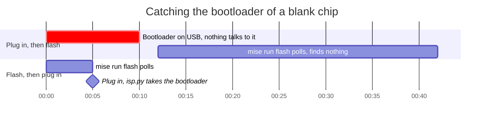

# Architecture

`main.rs` starts the chip and runs one polling loop with interrupts off.
Only `hw.rs` touches registers. The rest reaches the hardware through
three traits, `UsbRegs` (`usb.rs`), `SwdIo` (`swd.rs`) and `UartPort`
(`bridge.rs`), which `sim.rs` also implements for the host tests (dotted
lines). Smaller pieces: `touch.rs` spots the 1200 baud touch and
`linecode.rs` turns CDC line coding into UART divisors, both for
`bridge.rs`; `ring.rs` is the UART buffering in `hw.rs`; `regs.rs` holds
the register names.

## Flashing a blank chip

Why `mise run flash` starts before the plug-in: the bootloader's idle
timeout and isp.py's wait, from NOTES.md. The plug-in and start times
are examples.

